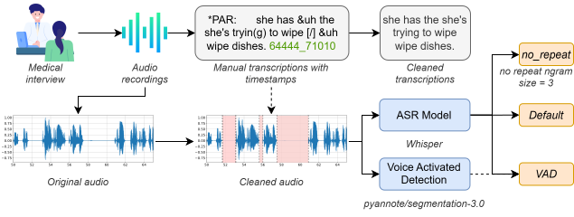

# Beyond Silence Stripping: Robust Whisper-Based ASR for Dementia Speech

This repository contains the code accompanying the paper **“Beyond Silence Stripping: Robust Whisper-Based ASR for Dementia Speech”**

The goal is to **adapt / fine-tune OpenAI Whisper** for spontaneous speech produced by **older adults** (healthy controls) and **people with dementia**, addressing common failure modes in atypical speech such as **long pauses**, **repetitions**, and other disfluency markers. In the paper, the proposed approach reports **18.77% WER (5-fold CV validation)** and **19.52% WER (test)** on the **ADReSS** benchmark.



---

## Method summary

At a high level (see Fig. 1 in the paper), the pipeline is:

1. **Clean CHAT transcripts (.cha)** to retain only the participant speech (typically `*PAR:`) and normalize text.
2. **Time-based segmentation** using CHAT timestamps to create Whisper-compatible clips (≤ 30 s) and remove very short segments.
3. Compare three inference variants aimed at reducing silence-related errors:
   - **Default**: standard Whisper decoding.
   - **VAD**: remove non-speech with `pyannote/segmentation-3.0` before ASR.
   - **no_repeat**: keep original audio, but set `no_repeat_ngram_size=3` to mitigate repetition loops.
4. **Fine-tune** Whisper (tiny/base/small/medium/large) using **subject-independent 5-fold cross-validation** and evaluate with **WER**.

---

## Repository layout

- `preprocess.py`  
  Entry point that runs preprocessing steps (cleaning, 30s segmentation, VAD, and plots).
- `preprocess/`
  - `audio.py`: removes interviewer speech, exports audio to 16 kHz mono.
  - `audio_30s.py`: timestamp-based segmentation + transcript cleaning for ≤30 s clips.
  - `transcription.py`: CHAT → normalized text.
  - `vad.py`: VAD-based trimming using `pyannote.audio`.
- `train.py`  
  Launches 5-fold CV fine-tuning for the five Whisper model sizes.
- `train_evaluate/`
  - `train.py`: fine-tuning with Hugging Face `transformers` (`Seq2SeqTrainer`), SpecAugment, early stopping.
  - `evaluate.py`: WER evaluation.
  - `test.py`: test-set evaluation (baseline + fine-tuned folds).
- `base_wer.py`  
  Computes baseline WER comparing `default`, `VAD`, and `no_repeat`.
- `plots/`  
  Plot scripts (violin/strip plots) built from CSVs under `resultados/`.
- `src/figures/fig1_methodology.png`  
  Figure included for convenient embedding in Markdown.

---

## Requirements

- Python 3.10+ recommended
- **FFmpeg** (required by `pydub`)
- NVIDIA GPU + CUDA (optional but recommended for medium/large training)

Main dependencies (approx.):
- `torch`
- `transformers`, `datasets`, `evaluate`
- `scikit-learn`
- `pydub`
- `pyannote.audio` (only if you use VAD)
- `bitsandbytes` (only for the `large` training configuration in this code)
- `pandas`, `matplotlib`, `seaborn` (plots)

Example install:

```bash
pip install -U torch transformers datasets evaluate scikit-learn pydub pandas matplotlib seaborn
pip install -U pyannote.audio
pip install -U bitsandbytes
```

### Hugging Face authentication (only for VAD)

`pyannote/segmentation-3.0` is hosted on the Hugging Face Hub and may require accepting the model’s conditions and authenticating to download weights.

Login via the official CLI:

```bash
pip install -U huggingface_hub
hf auth login
```

(See Hugging Face CLI docs.)

---

## Data: ADReSS

This repository **does not include** ADReSS. You must obtain the dataset through the ADReSS challenge / DementiaBank distribution channels.

The current `preprocess.py` expects the following directory structure (hard-coded defaults in the script):

- `dataset/train/Full_wave_enhanced_audio/cc` (control)
- `dataset/train/Full_wave_enhanced_audio/cd` (dementia)
- `dataset/train/transcription/{cc,cd}` (CHAT `.cha`)
- `dataset/test/Full_wave_enhanced_audio`
- `dataset/test/transcription`

> If your local paths differ, edit them directly in `preprocess.py`.

---

## Step 1 — Preprocessing

1) Update paths inside `preprocess.py` to point to your ADReSS folders.

2) Run:

```bash
python preprocess.py
```

By default, this creates (names may vary depending on your edits):

- `preprocessed_control/`, `preprocessed_dementia/` (cleaned audio + cleaned transcript text)
- `30s_control/`, `30s_dementia/`, `30s_test/` (≤30 s timestamp-based segments)
- `cut_30s_control/`, `cut_30s_dementia/` (VAD-trimmed segments)
- `resultados/` (CSVs/figures if you run VAD + plots)

---

## Step 2 — Baselines (Default vs VAD vs no_repeat)

To reproduce baseline comparisons:

```bash
python base_wer.py
```

Output (example): `resultados/Train_Baseline.json`.

---

## Step 3 — Training (5-fold CV)

Run fine-tuning for all five Whisper sizes:

```bash
python train.py
```

Notes:
- Each fold is stored as `whisper_<size>_fold<k>/...`
- Summary JSONs are written under `resultados/` (create the folder if missing).

---

## Step 4 — Test-set evaluation

```bash
python test.py
```

- `evaluateBaseline()` writes `resultados/Test_Baseline.json`
- `evaluateCV()` writes `resultados/Test_<size>.json`

---

## Citing

If you use this code, please cite the accompanying paper.
